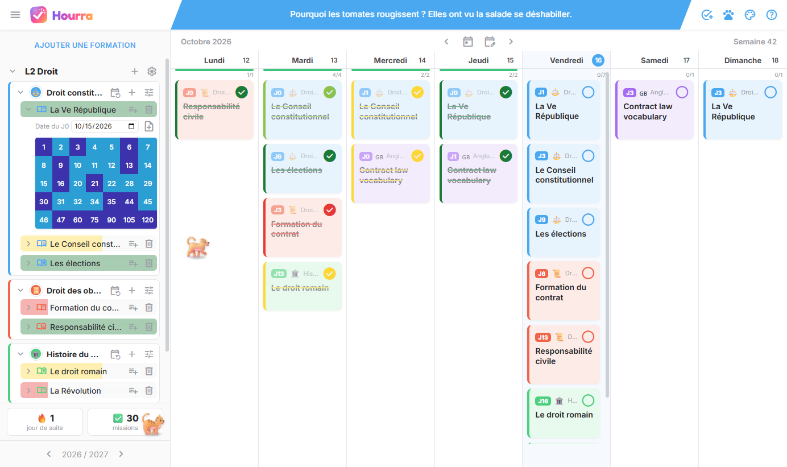
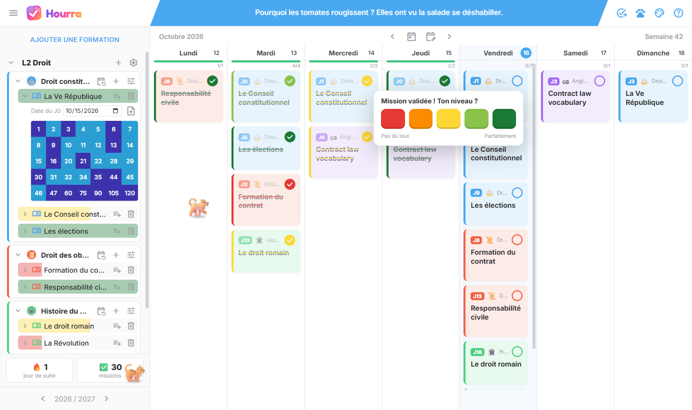
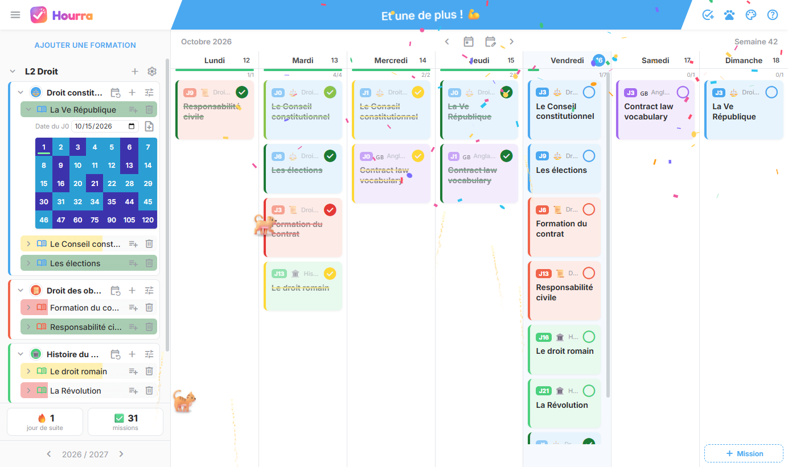
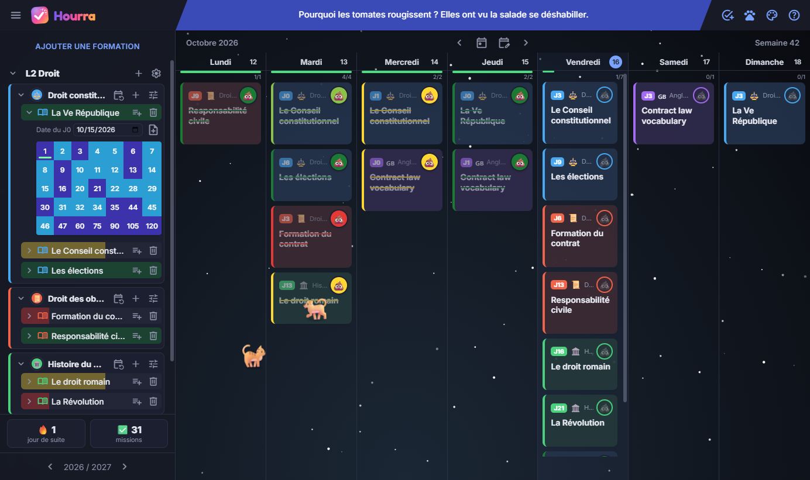
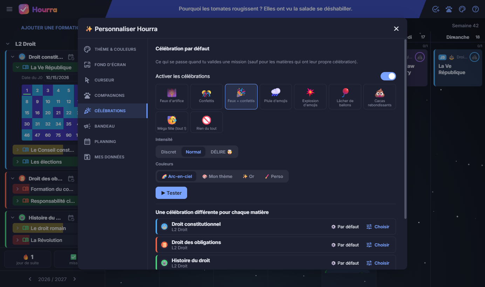

<div align="center">


# Hourra

**Ton planning de révisions avec la méthode des J : hors-ligne, sans compte, et entièrement personnalisable.**

[](https://github.com/TheoEwzZer/hourra/releases/latest)
[](https://github.com/TheoEwzZer/hourra/releases)
[](https://github.com/TheoEwzZer/hourra/actions/workflows/release.yml)

[](LICENSE)

[**⬇️ Télécharger pour Windows**](https://github.com/TheoEwzZer/hourra/releases/latest)



</div>

---

## Sommaire

- [Pourquoi Hourra ?](#pourquoi-hourra-)
- [Fonctionnalités](#fonctionnalités)
- [Captures d'écran](#captures-décran)
- [Installation](#installation)
- [La méthode des J](#la-méthode-des-j)
- [Vos données](#vos-données)
- [Développement](#développement)
- [Publier une nouvelle version](#publier-une-nouvelle-version)
- [Licence](#licence)

## Pourquoi Hourra ?

Hourra planifie tes révisions selon la **méthode des J**, une technique de répétition espacée : tu revois chaque cours à intervalles croissants (J1, J3, J6, J9…) pour l'ancrer dans ta mémoire à long terme. L'app s'inspire de [hiphiphip.app](https://www.hiphiphip.app) et fonctionne entièrement en local :

- **100 % hors-ligne** : aucune connexion, aucun compte, aucune donnée envoyée nulle part.
- **Motivante** : feux d'artifice, confettis, cochons qui pleuvent ou cacas rebondissants quand tu valides une mission.
- **À ton image** : thèmes, couleurs, fond d'écran, curseur, petits compagnons… tout se personnalise.

## Fonctionnalités

### 📅 Organisation
- **Planning de la semaine** : navigation par semaine, progression par jour, missions en retard à rapatrier en un clic, glisser-déposer entre les jours.
- **Mes cours** : formations → matières → cours, avec des matières suggérées selon la formation (lycée, PASS/LAS, droit, prépa…).
- **Méthode des J** : un J0 et une grille de 35 J (de J1 à J120), avec J1, J3, J6, J9, J13, J16, J21, J30, J35, J44, J47, J60, J75, J90, J105 et J120 cochés par défaut.
- **Tours de révisions** : répartit tous les cours d'une matière sur une période.
- **Missions libres** (tâches) avec répétition, couleur et emoji, et **notes** sur chaque session.

### 🎯 Suivi de la maîtrise
- En validant une mission, tu choisis ton **niveau** : rouge, orange, jaune, vert clair ou vert foncé.
- Chaque cours affiche une **barre de progression** de la couleur de ta dernière validation.
- Le **bouton de validation** est personnalisable : coche classique ou n'importe quel emoji (💩 compris), teinté de la couleur du niveau.

### 🎉 Célébrations
- Feux d'artifice, confettis, pluie d'emojis, explosion, lâcher de ballons, cacas rebondissants, ou tout à la fois.
- Une **célébration différente pour chaque matière**, et un grand final quand la journée est bouclée.
- Silencieuses par défaut.

### 🎨 Personnalisation
- **12 thèmes** prêts à l'emploi, chaque couleur modifiable, choix de la police et des arrondis.
- **Fond d'écran** : ta propre image, 15 ambiances animées, une couleur unie ou un dégradé (flou, luminosité, transparence).
- **Plus de 80 curseurs** (animaux, fun, classiques) et des traînées (paillettes, pattes, cœurs, arc-en-ciel…).
- **30 compagnons** animés qui se promènent, suivent ta souris, dorment, réagissent aux caresses et font la fête avec toi.
- **La p'tite blague du jour** dans le bandeau : 250 blagues, une nouvelle chaque jour.

## Captures d'écran

| Valider avec son niveau | Célébration |
| :---: | :---: |
|  |  |
| **Thème sombre, ambiance Espace et validation 💩** | **Personnalisation des célébrations** |
|  |  |

## Installation

Télécharge la dernière version sur la [page des releases](https://github.com/TheoEwzZer/hourra/releases/latest) :

| Fichier | Pour qui ? |
| --- | --- |
| `Hourra-Setup-x.y.z.exe` | **Recommandé.** Installe Hourra, crée un raccourci sur le bureau et **se met à jour tout seul**. |
| `Hourra-portable.exe` | Aucune installation : un seul fichier à lancer, par exemple depuis une clé USB. |

> [!NOTE]
> L'application n'est pas signée numériquement. Au premier lancement, Windows SmartScreen peut afficher « Windows a protégé votre ordinateur » : clique sur **Informations complémentaires**, puis sur **Exécuter quand même**.

### Mises à jour automatiques

La version installée vérifie au démarrage si une nouvelle version est disponible sur GitHub. Si c'est le cas, elle la télécharge en arrière-plan et l'installe à la prochaine fermeture de l'app. Sans connexion internet, rien ne se passe : l'app fonctionne normalement.

## La méthode des J

1. Le jour où tu découvres un cours, c'est ton **J0** : renseigne sa date dans « Mes cours ».
2. Hourra crée automatiquement une session de révision pour chaque J coché : J1, J3, J6, J9…
3. Chaque jour, valide tes missions en indiquant ton niveau de maîtrise.
4. La barre de progression du cours montre où tu en es, du rouge au vert foncé.

Tu peux changer les J cochés par défaut (réglages **Planning**), par matière, ou pour chaque cours.

## Vos données

- Tout est enregistré localement dans `%APPDATA%\Hourra\hourra-data.json`, avec une écriture atomique pour éviter toute corruption.
- Les fonds d'écran importés sont copiés dans `%APPDATA%\Hourra\backgrounds`.
- **Exporter / Importer** une sauvegarde JSON depuis **Personnaliser → Mes données**.
- Aucune télémétrie. La seule requête réseau est la vérification des mises à jour de la version installée.

## Développement

**Prérequis :** [Node.js](https://nodejs.org) 20 ou plus récent, sous Windows.

```bash
git clone https://github.com/TheoEwzZer/hourra.git
cd hourra
npm install
npm start          # lance l'app en mode développement
npm run dist       # génère l'icône, l'installeur et la version portable dans dist/
```

### Stack

- [Electron](https://www.electronjs.org) pour l'application de bureau, [electron-builder](https://www.electron.build) pour l'installeur NSIS et la version portable, et [electron-updater](https://www.electron.build/auto-update) pour les mises à jour.
- Interface en **HTML, CSS et JavaScript (modules ES)**, sans framework ni étape de compilation.
- Polices et icônes embarquées (Inter, Nunito, Fredoka, Material Symbols…) pour un fonctionnement 100 % hors-ligne.

### Structure

```
src/
├── main.js            Processus principal : fenêtre, fichiers, dialogues, mises à jour
├── preload.js         Pont sécurisé (contextIsolation) entre le rendu et le système
└── renderer/
    ├── index.html
    ├── css/           Styles et polices
    ├── assets/        Logo et icône
    ├── vendor/        Polices embarquées
    └── js/
        ├── app.js         Démarrage, en-tête, raccourcis clavier
        ├── store.js       État, sauvegarde, migrations, méthode des J
        ├── planning.js    Planning de la semaine et validation des missions
        ├── drawer.js      Menu « Mes cours »
        ├── settings.js    Fenêtre de personnalisation
        ├── fireworks.js   Célébrations
        ├── pets.js        Compagnons animés
        ├── cursors.js     Curseurs et traînées
        ├── ambiance.js    Fonds animés
        ├── themes.js      Thèmes et couleurs
        ├── banner.js      Bandeau et blague du jour
        └── jokes.js       Les 250 blagues
scripts/
└── make-icon.js       Génère l'icône de l'app à partir du logo SVG
```

## Publier une nouvelle version

La publication est automatisée par [GitHub Actions](.github/workflows/release.yml) :

```bash
npm version patch      # ou minor / major : met à jour package.json et crée le tag
git push --follow-tags
```

Le workflow construit l'app sous Windows et ajoute l'installeur, la version portable et `latest.yml` (utilisé par la mise à jour automatique) à la release du tag.

## Licence

Distribué sous licence [MIT](LICENSE). Hourra est un projet indépendant, inspiré de hiphiphip.app, sans lien avec ce service.
